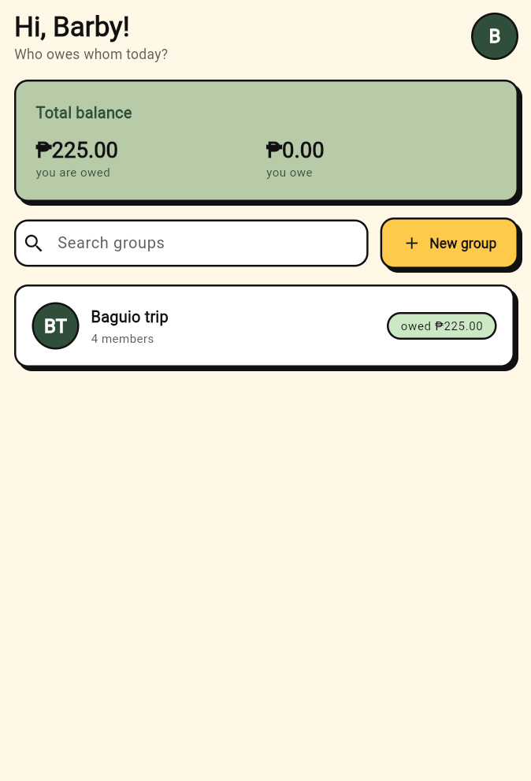
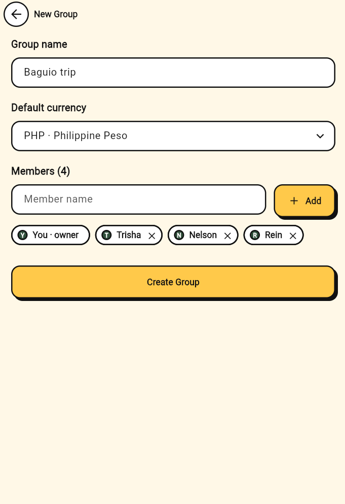
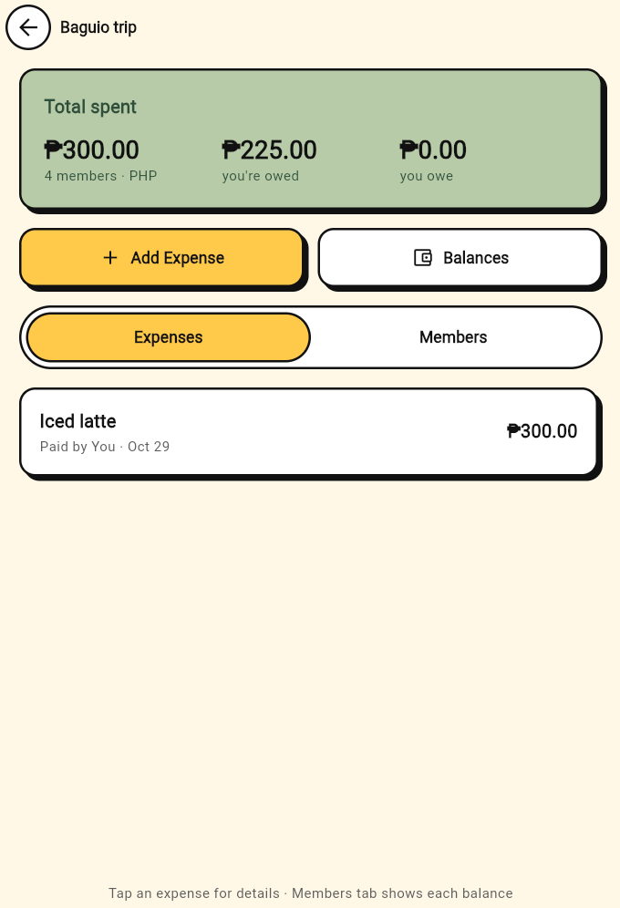
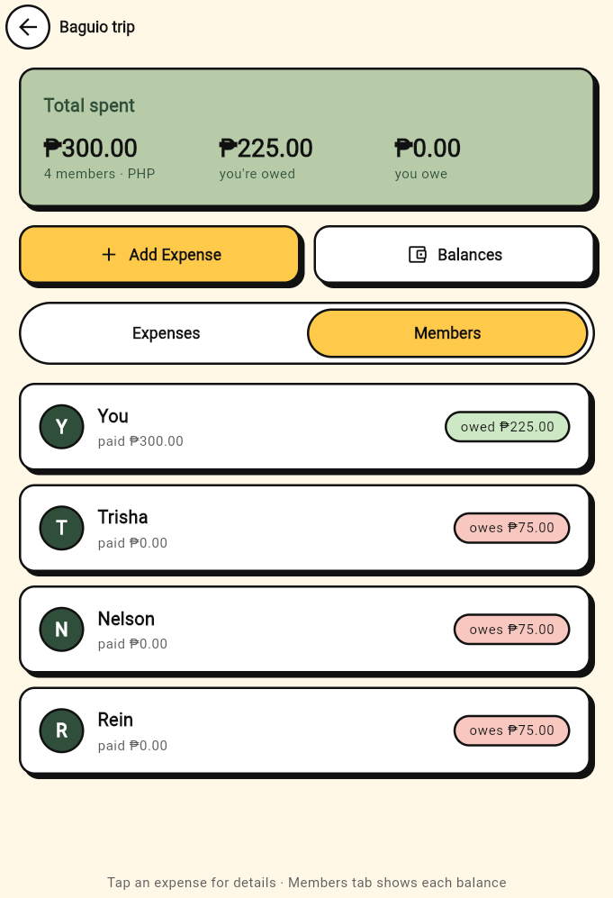
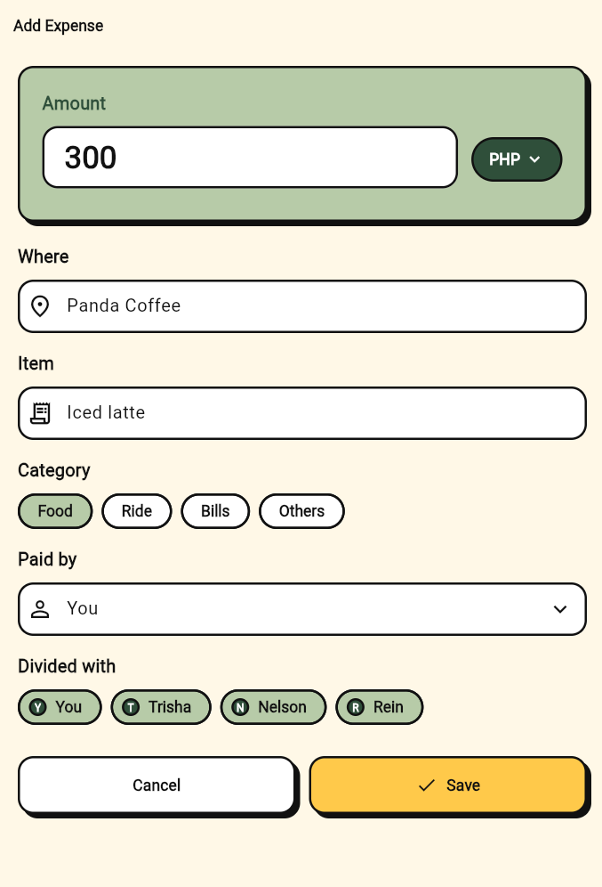
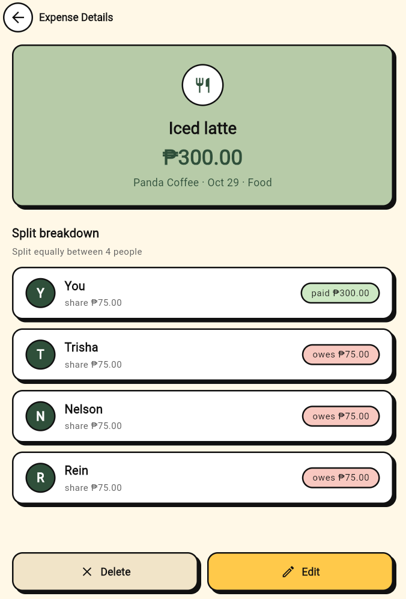
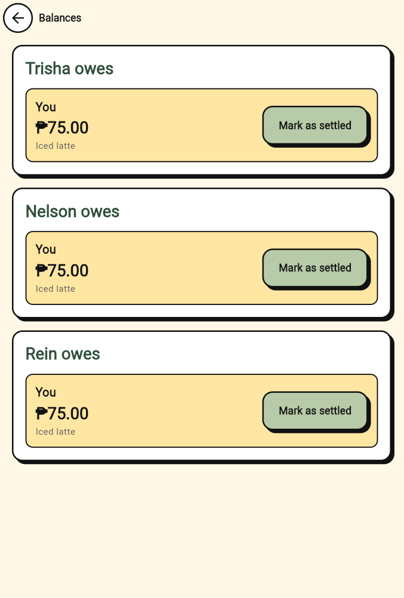
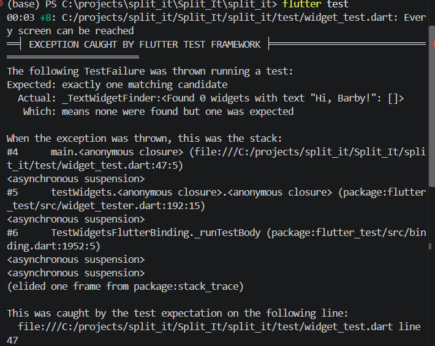
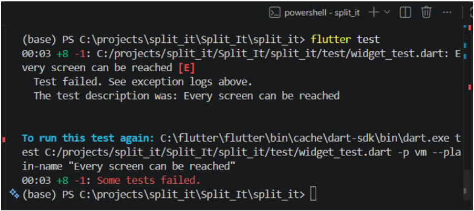

# Split It

Split It is an Android app for splitting shared expenses with friends, family or roommates. You make a group, log who paid for what, and the app works out who owes whom. Expenses paid in a foreign currency are converted to pesos using live exchange rates from the [Frankfurter API](https://frankfurter.dev/).

Built with Flutter for SE2142 (Software Engineering Tools and Practices), Final Project 2026.

## Screenshots

| Home | Add Group | Group Details: Expenses | Group Details: Members |
| :---: | :---: | :---: | :---: |
|  |  |  |  |

| Add / Edit Expense | Expense Detail | Balances |
| :---: | :---: | :---: |
|  |  |  |

## Features

- **Groups:** create a group with a name, a default currency and its members, and delete it by swiping it away on Home.
- **Search:** filter groups by name from the Home search bar.
- **Expenses:** add, view, edit and delete expenses. Each one records where, what, the amount, the category, who paid and who shared it.
- **Equal split:** each expense is split equally between the members who shared it.
- **Balances:** see who owes whom in each group, plus a total of what you owe and are owed on Home.
- **Mark as settled:** after a confirmation, a paid debt drops out of the balances and is shown as "Settled ✓".
- **Currency conversion:** foreign-currency amounts are converted to PHP with the latest Frankfurter rate, shown live as you type.
- **Saved on the device:** groups and expenses are kept between app launches.
- **Offline handling:** if rates can't be loaded, the app shows a message with a Retry button, and PHP expenses still work.
- **Form validation and empty states** on every form and list.

## Packages

| Package | Used for |
| --- | --- |
| [provider](https://pub.dev/packages/provider) `^6.1.5+1` | Shared app state (`ChangeNotifier`) |
| [http](https://pub.dev/packages/http) `^1.6.0` | Calls to the Frankfurter REST API |
| [shared_preferences](https://pub.dev/packages/shared_preferences) `^2.5.6` | Saving groups on the device |
| [flutter_launcher_icons](https://pub.dev/packages/flutter_launcher_icons) `^0.14.4` (dev) | Generating the app icon |
| [flutter_native_splash](https://pub.dev/packages/flutter_native_splash) `^2.4.8` (dev) | The native launch screen |
| [flutter_lints](https://pub.dev/packages/flutter_lints) `^6.0.0` (dev) | Lint rules for `flutter analyze` |

**API:** [Frankfurter](https://frankfurter.dev/) (no API key needed)
- `GET https://api.frankfurter.dev/v2/rates?base=PHP` returns the exchange rates
- `GET https://api.frankfurter.dev/v2/currencies` returns the list of currencies

## Project structure

```
split_it/lib/
├── main.dart          # app entry, providers and MaterialApp
├── app_routes.dart    # named routes
├── models/            # Group, Member, Expense, Debt, ExchangeRate, Currency
├── providers/         # GroupProvider, BalanceProvider, CurrencyProvider, HomeProvider
├── services/          # FrankfurterService (API), StorageService (device storage)
├── screens/           # one file per screen
├── widgets/           # reusable widgets
└── theme/             # colors and app theme
```

## Getting started

**Requirements:** Flutter 3.44 or newer (Dart 3.12+), Android Studio or VS Code, and an Android phone or emulator. The app needs an internet connection for currency rates.

```bash
git clone https://github.com/hystrawr/Split_It.git
cd Split_It/split_it
flutter pub get
```

Run in debug mode on a connected phone or emulator:

```bash
flutter run
```

Run the checks:

```bash
flutter analyze
flutter test
```

### Building the APK

Debug build:

```bash
flutter build apk --debug
```

Release build:

```bash
flutter build apk --release
```

The APKs are written to `split_it/build/app/outputs/flutter-apk/` (`app-debug.apk` and `app-release.apk`).

### Installing on a phone

**With a USB cable:** turn on Developer options and USB debugging on the phone, plug it in, allow the debugging prompt, then run:

```bash
flutter install --release
```

**Without a cable:** copy `app-release.apk` to the phone, open it, and allow installing from unknown sources when asked.

If an older version of Split It is already installed and the install fails, uninstall it first.

## Team

| Member | GitHub | Role |
| --- | --- | --- |
| Barby Clarise D. Peregil | [@barbyclarise](https://github.com/barbyclarise) | UI lead: theme, navigation, reusable widgets, some providers, and screens |
| Trisha B. Jambaro | [@hystrawr](https://github.com/hystrawr) | Logic lead: models, API service, providers, balance calculation, tests and APK |

## Debugging case

**Problem:** After validation was added to Add Group, the "Every screen can be reached" widget test started failing (8 passed, 1 failed).

**How we found it:** The `flutter test` stack trace pointed to `test/widget_test.dart` line 47, which found 0 widgets with the text "Hi, Barby!". The test tapped Create Group and expected to land back on Home, but the app stayed on the New Group screen.





**Cause:** The test tapped Create Group on an empty form, so validation kept the screen open.

**Fix:** The test now fills in a name and a member before tapping Create Group. Merged in PR #31.
